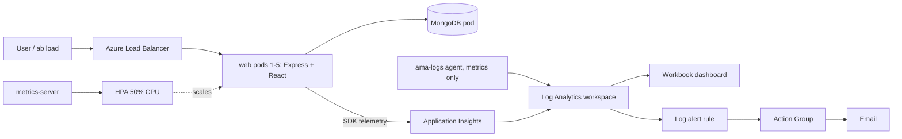

# FoCC Lab 2 - MERN on Azure AKS

A task tracker with a visitor counter (React + Express + MongoDB), packaged in Docker, autoscaled on Azure Kubernetes Service with an HPA, and monitored with Azure Monitor.

**Student:** [Mustafa] &nbsp;|&nbsp; **Azure account:** [mustafa.qureshi@avantika.edu.in]

## What's inside

| Path | Purpose |
|---|---|
| `client/` | React front end (Vite) |
| `server/` | Express API, health probes, `/api/compute` CPU burner for load tests |
| `Dockerfile` | Multi-stage build (deps, client build, non-root runtime) |
| `docker-compose.yml` | Local run: web + MongoDB on one network |
| `k8s/` | Deployment, Service, HPA and MongoDB manifests |
| `dcr-settings.json` | Container Insights settings (metrics only) |
| `alert.json` | High-CPU log alert rule (ARM template) |
| `monitoring/` | Azure Monitor Workbook with the five dashboard charts |

## Architecture



## Prerequisites

Docker Desktop, Azure CLI (`az login` done), `kubectl`, and an Azure subscription. Replace `<acr>` below with your registry name.

## Run locally

```bash
docker compose up --build -d
curl localhost:3000/api/visits
```

Then open http://localhost:3000

## Build and push (ACR)

```bash
az acr login -n <acr>
docker build --platform linux/amd64 -t <acr>.azurecr.io/lab2-web:v2 . && docker push <acr>.azurecr.io/lab2-web:v2
```

Then set the same image name in `k8s/deployment.yaml` (replace `<ACR_NAME>`).

## Deploy to AKS

```bash
az aks get-credentials -g lab2-rg -n lab2-aks
kubectl create secret generic appi --from-literal=conn="<app insights connection string>"
kubectl apply -f k8s/
kubectl get pods,svc,hpa
```

The secret is optional: without it the app still runs, it just doesn't send request telemetry. The web Service gets a public `EXTERNAL-IP` after a minute or two.

## Monitoring

- **Container Insights** collects metrics only (`dcr-settings.json`, no raw container logs):

  ```bash
  az aks enable-addons -a monitoring -g lab2-rg -n lab2-aks \
    --workspace-resource-id <workspace-id> --data-collection-settings dcr-settings.json
  ```

- **Application Insights** provides HTTP request count and P95 latency.
- **Dashboard:** import `monitoring/workbook.json` into an Azure Monitor Workbook (CPU, memory, requests, P95, replicas). Set your workspace ID in `fallbackResourceIds`.
- **Alert:** deployed from `alert.json` (web CPU above 75% of its 200m limit for 2+ minutes), e-mailing the action group:

  ```bash
  az deployment group create -g lab2-rg --template-file alert.json \
    --parameters workspaceId=<workspace-id> actionGroupId=<action-group-id>
  ```

## Load test

Open three terminals: `kubectl get hpa -w`, `kubectl get pods -w`, and

```bash
ab -t 180 -c 100 http://<EXTERNAL-IP>/api/compute
```

Keep each run under 5 minutes. The HPA should add replicas as CPU passes 50% of the request.

## Cleanup

```bash
az group delete -n lab2-rg --yes
```

This removes the cluster, registry, workspace, Application Insights, action group and alert rule.
